# Mis Tareas: resumen completo del proyecto

Aplicación móvil de lista de tareas (ToDo List) con **React Native y Expo SDK 58**, hecha para la Evaluación de la Unidad 1 de Desarrollo de aplicaciones móviles.

**Docente:** Boris Belmar | **Sección:** 51

**Integrantes:** Florencia Vergara, Agustina Barbaroy y Andrea Carreño.

**Informe de la evaluación:** [EVU1_TODOLIST.pdf](EVU1_TODOLIST.pdf)

**Repositorio:** https://github.com/AndreaVCC/EVU1_TODOLIST

docs/EVU1_TODOLIST.mp4

## Índice

1. [Cómo ejecutar la app](#1-cómo-ejecutar-la-app)
2. [Nuestras elecciones y por qué](#2-nuestras-elecciones-y-por-qué)
3. [Qué se instaló y qué se eliminó](#3-qué-se-instaló-y-qué-se-eliminó)
4. [Las vistas de la app](#4-las-vistas-de-la-app)
5. [Funcionalidades](#5-funcionalidades)
6. [Estructura de archivos](#6-estructura-de-archivos)
7. [Temas, colores y transparencias](#7-temas-colores-y-transparencias)
8. [Contraste medido](#8-contraste-medido)
9. [Estándares de Android e iOS](#9-estándares-de-android-e-ios)
10. [Buenas prácticas y patrones](#10-buenas-prácticas-y-patrones)
11. [Cómo comprobar el trabajo](#11-cómo-comprobar-el-trabajo)

---

## 1. Cómo ejecutar la app

```bash
npm install                  # solo la primera vez
npm start -- --clear         # abre el servidor limpiando la caché
```

| Dónde                          | Cómo                                                        |
| ------------------------------ | ----------------------------------------------------------- |
| Teléfono en la misma red Wi-Fi | Escanea el QR con Expo Go compatible con SDK 58             |
| Teléfono en otra red           | `npm start -- --tunnel --clear` (requiere `npx expo login`) |
| Navegador                      | `npm run web`, luego abre <http://localhost:8100>           |
| Emulador Android               | `npm run android` (requiere Android Studio)                 |

Otros comandos:

```bash
npm run typecheck        # revisa los tipos de TypeScript
npm run lint             # revisa el estilo y errores comunes
npm run check:contrast   # mide el contraste de los cinco temas
npx expo-doctor          # revisa la configuración del proyecto
```

> **Si aparece un error de compilación o la app muestra algo viejo:** cierra el servidor con `Ctrl+C` y vuelve a abrirlo con `--clear`. También hay que reiniciarlo después de cambiar `app.json` o instalar paquetes.

---

## 2. Nuestras elecciones y por qué

### Tecnología

| Elección                       | Alternativa descartada          | Motivo                                                                                                                                     |
| ------------------------------ | ------------------------------- | ------------------------------------------------------------------------------------------------------------------------------------------ |
| **React Native y Expo**        | Ionic, que pide la pauta        | Autorizado por el docente. El informe muestra la equivalencia con cada componente de Ionic                                                 |
| **Node.js y npm**              | Otro gestor de paquetes         | Node.js ejecuta las herramientas de desarrollo y npm instala las dependencias; solo se usan durante el desarrollo, no en la app instalada |
| **Expo Router**                | Configurar la navegación a mano | Lo recomienda la guía del proyecto: cada archivo es una pantalla                                                                           |
| **TypeScript estricto**        | JavaScript                      | Detecta errores antes de ejecutar la app                                                                                                   |
| **Context y reducer**          | Redux, Zustand                  | La app es pequeña y no necesita otra dependencia                                                                                           |
| **AsyncStorage**               | SQLite, guardar nada            | Basta con guardar una lista. La pauta lo deja para más adelante, pero perder las tareas al cerrar la app sería un problema grave           |
| **`expo-symbols` para iconos** | `@expo/vector-icons`            | Expo avisa que ese paquete quedará obsoleto. `expo-symbols` ya estaba instalado, viene en Expo Go y muestra iconos propios de cada sistema |

### Diseño

| Elección | Alternativa descartada | Motivo |
| -------- | ---------------------- | ------ |
| **Cinco temas elegibles y modo automático** | Una sola paleta de colores | Cada persona elige cómo se ve la app, y la opción automática respeta el modo de su teléfono |
| **Claro y Oscuro en marfil, grafito y champán** | Blanco y negro puros | Los tonos cálidos y neutros se ven más elegantes y cansan menos la vista |
| **Rosado, Azul y Verde en tonos profundos** | Colores saturados | Rosa antiguo, azul medianoche y verde bosque permiten texto blanco con buen contraste |
| **Transparencias sin desenfoque** | Efecto vidrio con `expo-blur` | El contraste se puede calcular y se ve igual en todos los teléfonos. El desenfoque varía entre plataformas y puede afectar el rendimiento |
| **Superficies opacas en menús, diálogos y campos** | Todo translúcido | Lo importante debe leerse siempre bien |
| **Encabezados oscuros en todos los temas** | Encabezado claro en tema Claro | Da identidad común y permite mantener siempre clara la barra de estado |
| **Icono de la app en grafito y champán** | Un icono por tema | Un icono único es más simple y el sistema lo muestra antes de elegir tema |

### Experiencia de uso

| Elección                                     | Alternativa descartada     | Motivo                                                               |
| -------------------------------------------- | -------------------------- | -------------------------------------------------------------------- |
| **Formulario en su propia pantalla**         | Formulario sobre la lista  | Da espacio al teclado y a los mensajes de error                      |
| **Botones visibles de editar y eliminar**    | Deslizar para ver acciones | Los pide la pauta y se descubren sin instrucciones                   |
| **Confirmar antes de eliminar**              | Eliminar de inmediato      | Evita pérdidas por un toque accidental                               |
| **Diálogo propio**                           | `Alert.alert`              | `Alert` no funciona en web y no adopta el tema                       |
| **Título y descripción obligatorios**        | Descripción opcional       | La pauta indica que cada tarea debe tener ambos                      |
| **“Guardar y agregar otra”**                 | Solo “Guardar”             | Agiliza ingresar varias tareas y muestra que el formulario se limpia |
| **Tres pestañas: Tareas, Resumen y Ajustes** | Todo en una pantalla       | Separa el trabajo diario de la consulta y la configuración           |
| **Tema Automático por defecto**              | Forzar uno                 | Respeta lo que la persona ya eligió en su teléfono                   |

### Elecciones técnicas de implementación

| Elección                                                          | Motivo                                                                                                    |
| ----------------------------------------------------------------- | --------------------------------------------------------------------------------------------------------- |
| Colores en `src/constants/themes.ts`, sin importar nada de la app | Permite que el script de contraste los lea directamente                                                   |
| Librería `culori` para medir el contraste                         | Es una librería de color probada, en lugar de programar la fórmula y la mezcla de transparencias a mano   |
| Comando `check:contrast` en el proyecto                           | El contraste se mide y falla si no cumple, en lugar de depender de la vista                               |
| Propiedades `aria-*` en vez de `accessibilityState`               | Funcionan en Android, iOS y web; la otra no llega al navegador                                            |
| `typedRoutes` desactivado                                         | Generaba rutas falsas y errores de compilación                                                            |
| `web.output` en `single`                                          | La app guarda todo en el dispositivo y no usa funciones de servidor; así se evita compilar y renderizar en el servidor |
| Sin `useMemo` ni `useCallback` manuales                           | React Compiler, activo en `app.json`, optimiza automáticamente                                            |
| Identificadores `com.ipss.mistareas`                              | Android e iOS exigen uno para compilar. Es provisional: cámbienlo si publican la app                      |

---

## 3. Qué se instaló y qué se eliminó

### Paquetes agregados

| Paquete                                     | Versión | Para qué                                | Tipo       |
| ------------------------------------------- | ------- | --------------------------------------- | ---------- |
| `@react-native-async-storage/async-storage` | 2.2.0   | Guardar tareas y tema en el dispositivo | Producción |
| `eslint`                                    | ^9.39.5 | Revisar la calidad del código           | Desarrollo |
| `eslint-config-expo`                        | ~58.0.4 | Reglas de ESLint para Expo              | Desarrollo |
| `culori`                                    | ^4.0.2  | Calcular contraste y mezclar colores    | Desarrollo |
| `@types/culori`                             | ^4.0.1  | Tipos de TypeScript para `culori`       | Desarrollo |
| `playwright-core`                           | ^1.64.1 | Probar los flujos en el navegador       | Desarrollo |

El proyecto se creó con la plantilla de SDK 58, y los paquetes se instalaron con `npx expo install`, que elige las versiones compatibles con el SDK:

```bash
npx create-expo-app todolist --template default@sdk-58
npx expo install @react-native-async-storage/async-storage
npx expo install eslint eslint-config-expo -- --dev
npx expo install culori @types/culori playwright-core -- --dev
```

### Paquetes eliminados porque no se usaban

`@expo/ui`, `expo-device`, `expo-glass-effect`, `expo-image` y `expo-web-browser`.

### Paquetes principales que se mantienen

| Paquete                          | Versión         | Uso                                                          |
| -------------------------------- | --------------- | ------------------------------------------------------------ |
| `expo`                           | ~58.0.22        | Framework base                                               |
| `react` / `react-native`         | 19.3.0 / 0.88.1 | Interfaz                                                     |
| `expo-router`                    | ~58.0.29        | Navegación por archivos                                      |
| `expo-symbols`                   | ~58.0.4         | Iconos: SF Symbols en iOS, Material Symbols en Android y web |
| `expo-font`                      | ~58.0.11        | Carga de la fuente de iconos                                 |
| `expo-splash-screen`             | ~58.0.12        | Pantalla de inicio                                           |
| `expo-status-bar`                | ~58.0.4         | Barra de estado                                              |
| `expo-system-ui`                 | ~58.0.7         | Color de fondo del sistema según el tema                     |
| `react-native-reanimated`        | 4.7.1           | Animaciones                                                  |
| `react-native-safe-area-context` | ~5.10.1         | Respetar muescas y barras del sistema                        |
| `react-native-screens`           | ~4.30.0         | Pantallas nativas de la navegación                           |
| `react-native-web`               | ~0.21.4         | Ejecutar la app en el navegador                              |

### Archivos de la plantilla eliminados

- **Pantallas:** `src/app/explore.tsx` y el `src/app/index.tsx` original.
- **Componentes:** `animated-icon` (3 archivos), `app-tabs` (2 archivos), `external-link`, `hint-row`, `web-badge`, `themed-view` y `ui/collapsible`.
- **Otros:** `scripts/reset-project.js` e imágenes de Expo y React que no se usaban.

### Configuración cambiada

| Archivo                             | Cambio                                                                                                   |
| ----------------------------------- | -------------------------------------------------------------------------------------------------------- |
| `app.json`                          | Nombre “Mis Tareas”, colores de icono y pantalla de inicio, identificadores, y `typedRoutes` desactivado |
| `package.json`                      | Scripts `web` en el puerto 8100, `typecheck` y `check:contrast`; se quitó `reset-project`                |
| `tsconfig.json`                     | Permite importar `.ts` en el script de contraste                                                         |
| `eslint.config.js`                  | Archivo nuevo con la configuración de Expo                                                               |
| `assets/images/`                    | Iconos nuevos: app, favicon, Android adaptable y monocromo, y pantalla de inicio                         |
| `src/hooks/use-color-scheme.web.ts` | Se corrigió un error de lint que venía en la plantilla                                                   |

---

## 4. Las vistas de la app

```text
Stack
├─ Pestañas
│  ├─ Tareas   (src/app/(tabs)/index.tsx)
│  ├─ Resumen  (src/app/(tabs)/summary.tsx)
│  └─ Ajustes  (src/app/(tabs)/settings.tsx)
└─ Formulario  (src/app/task-form.tsx)
```

### Tareas: lista vacía

Lo primero que se ve. Explica qué hacer y ofrece un botón directo para agregar la primera tarea.

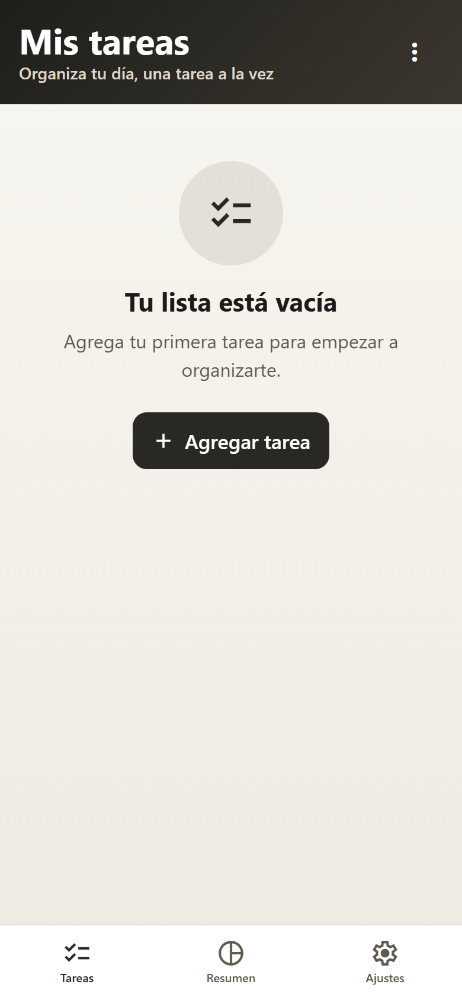

### Tareas: lista con contenido

- **Encabezado:** título, tareas pendientes, porcentaje y barra de progreso.
- **Filtros:** Todas, Pendientes y Listas, con su cantidad.
- **Cada tarea:** círculo para completar, título, descripción, fecha, y botones de editar y eliminar.
- **Botón flotante:** “Nueva tarea”.
- **Barra inferior:** tres pestañas e insignia con las pendientes.

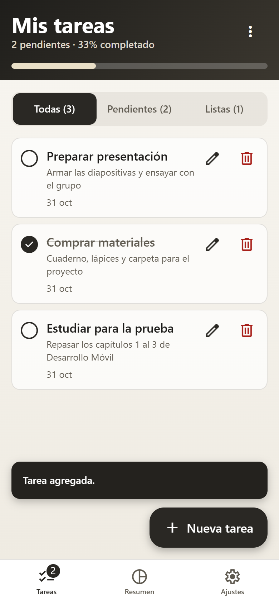

### Menú de opciones

Se abre con los tres puntos. Permite ordenar por fecha, completar todas y eliminar las completadas. Las opciones que no se pueden usar quedan deshabilitadas.

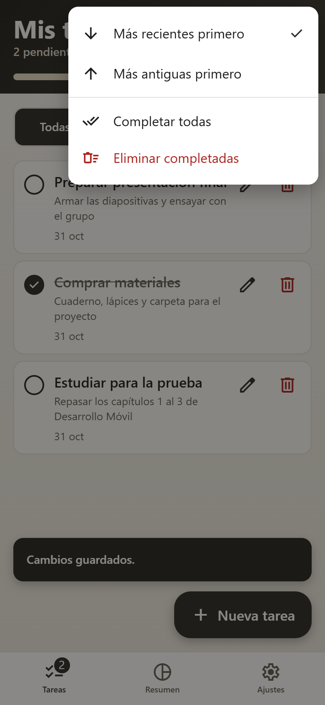

### Formulario: nueva tarea

Tiene Título (máximo 60 caracteres) y Descripción (máximo 200), con contador. “Guardar tarea” vuelve a la lista y “Guardar y agregar otra” limpia los campos para seguir escribiendo.

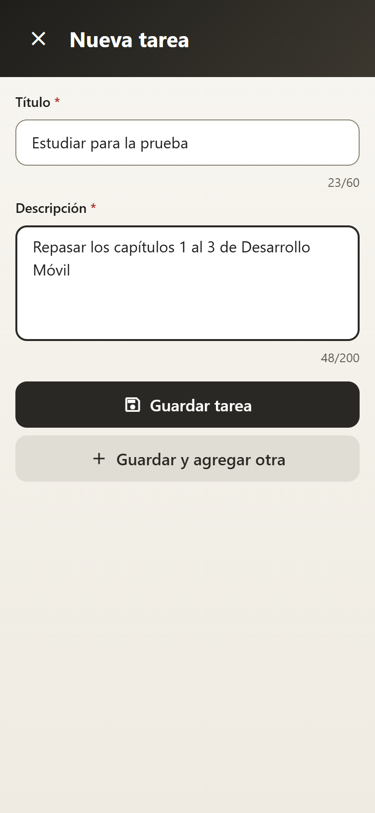

### Formulario: validación

Si falta un dato, indica qué corregir junto al campo, con color, icono y texto, y lleva el cursor al primer error.

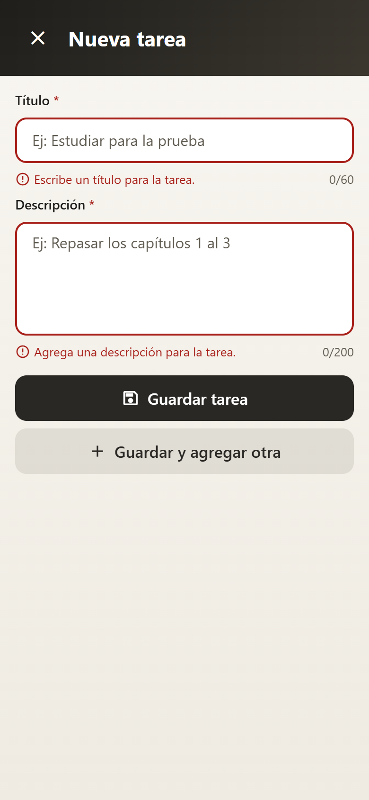

### Formulario: editar y aviso de descarte

Se abre con los datos de la tarea. Si cierras con cambios sin guardar, pregunta antes de descartarlos.

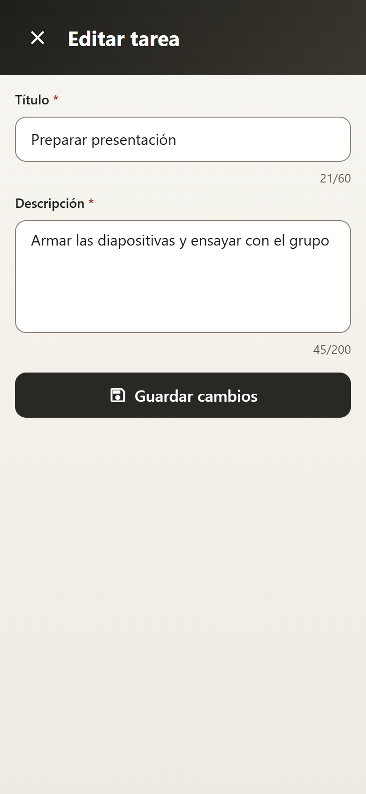 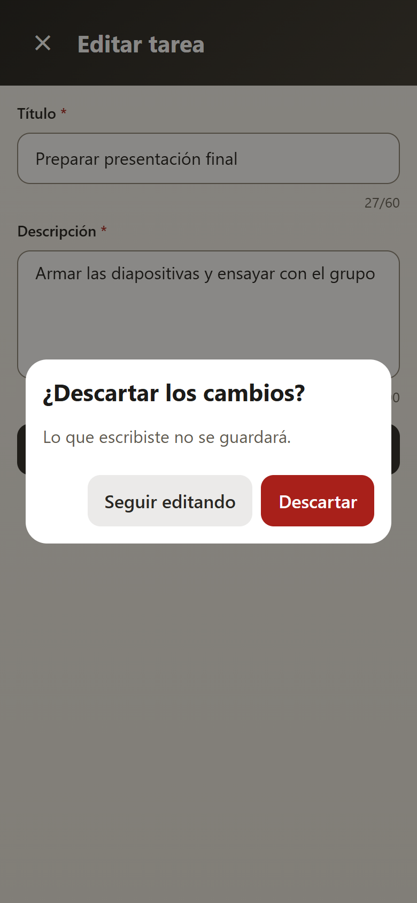

### Confirmación al eliminar

Nombra la tarea para evitar errores y permite cancelar.

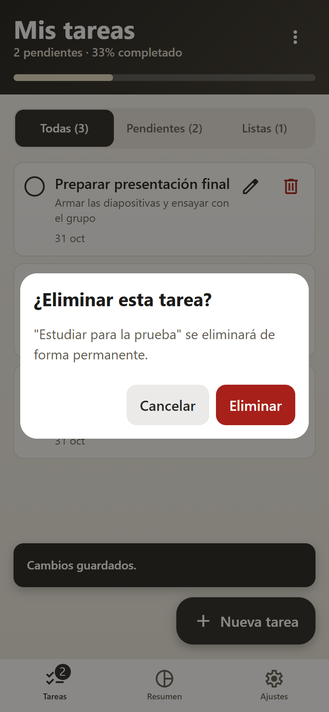

### Resumen

Muestra el avance general, un mensaje según el progreso y el total de tareas, pendientes y completadas.

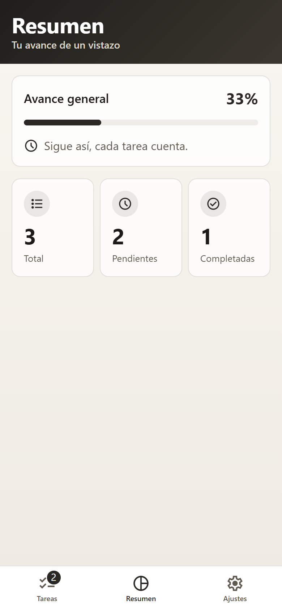

### Ajustes: elegir tema

Seis opciones con muestra de color. El cambio es inmediato y queda guardado.

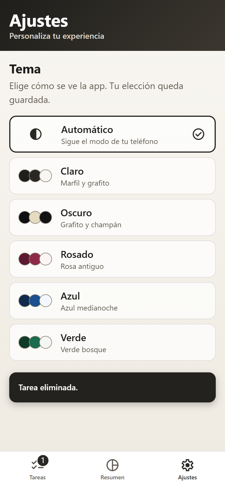

### Los cinco temas

| Claro                                                                  | Oscuro                                                                   | Rosado                                                                   | Azul                                                                 | Verde                                                                  |
| ---------------------------------------------------------------------- | ------------------------------------------------------------------------ | ------------------------------------------------------------------------ | -------------------------------------------------------------------- | ---------------------------------------------------------------------- |
| 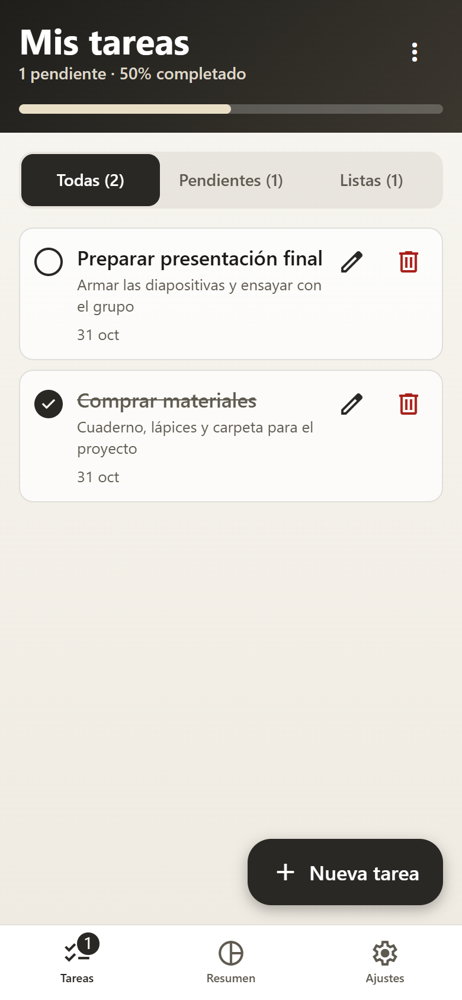 | 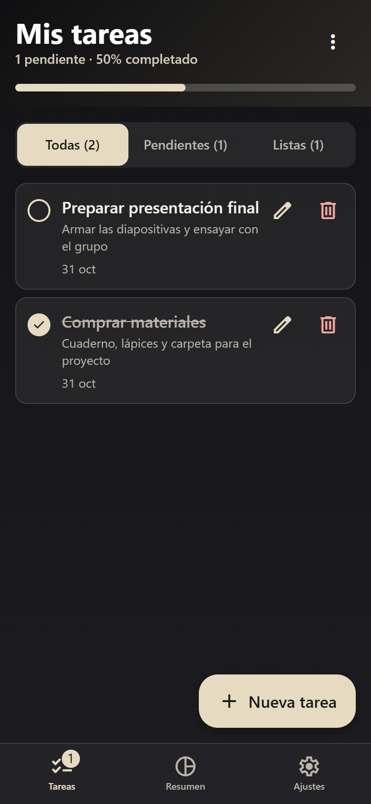 | 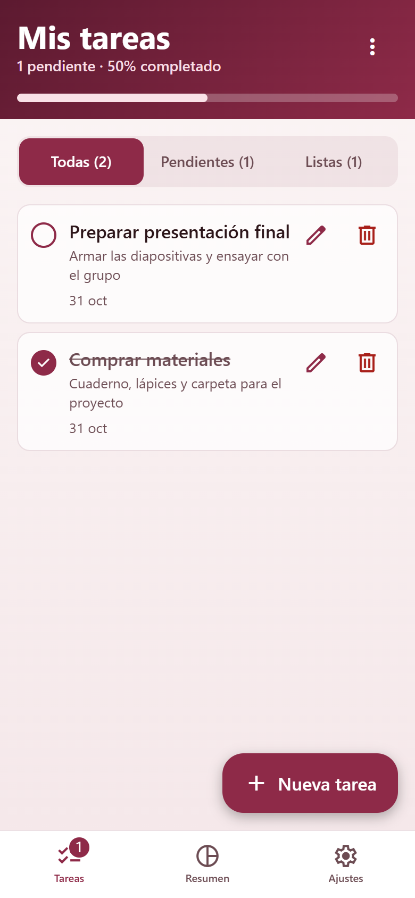 | 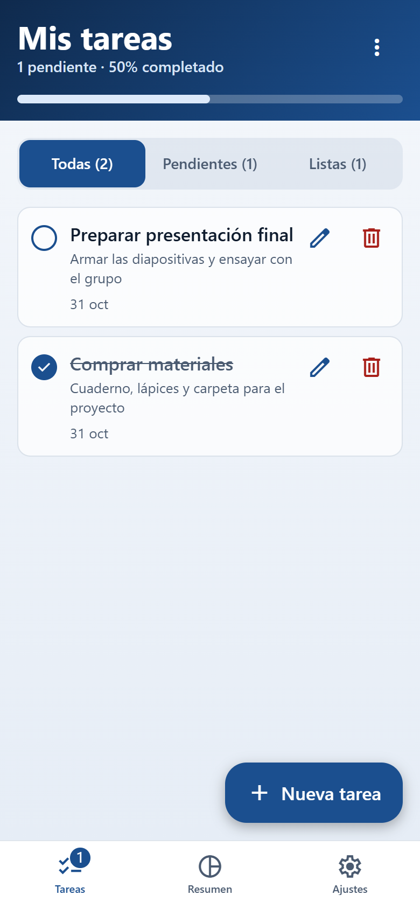 | 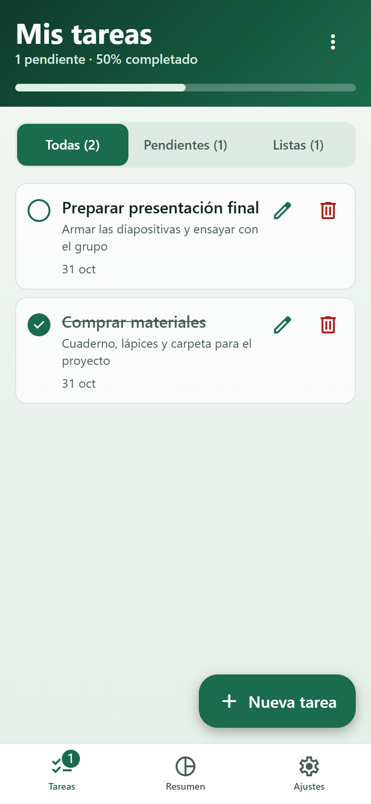 |

---

## 5. Funcionalidades

### Pedidas por la pauta

- Agregar tareas con título y descripción.
- Visualizar la lista.
- Editar tareas.
- Eliminar con un botón junto a cada tarea.
- Limpiar el formulario después de agregar.

### Agregadas para mejorar la experiencia

- Elegir entre cinco temas o seguir el modo del teléfono.
- Marcar tareas como completadas.
- Filtrar y ordenar.
- Completar todas o eliminar las completadas.
- Ver el resumen de avance.
- Guardar automáticamente tareas y tema en el dispositivo.
- Mensajes breves de confirmación.
- Aviso al salir con cambios sin guardar.
- Aviso si se abre una tarea que ya no existe.

---

## 6. Estructura de archivos

```text
todolist/
├─ app.json                       Configuración de la app
├─ eslint.config.js               Reglas de calidad de código
├─ assets/images/                 Iconos y pantalla de inicio
├─ scripts/
│  ├─ check-contrast.ts           Revisa el contraste de los temas
│  └─ test-flows.js               Prueba los flujos de la app
├─ docs/
│  ├─ README.md                   Este documento
│  ├─ EVU1_Informe_ToDoList_IPSS.docx   Informe para entregar
│  └─ capturas/                   Capturas de pantalla
└─ src/
   ├─ global.css                  Foco de los campos en web
   ├─ app/                        Rutas: cada archivo es una pantalla
   │  ├─ _layout.tsx              Providers, tema y navegador Stack
   │  ├─ task-form.tsx            Formulario de crear y editar
   │  └─ (tabs)/
   │     ├─ _layout.tsx           Barra de pestañas
   │     ├─ index.tsx             Lista de tareas
   │     ├─ summary.tsx           Resumen
   │     └─ settings.tsx          Ajustes y elección de tema
   ├─ components/
   │  ├─ empty-state.tsx          Mensaje cuando no hay contenido
   │  ├─ filter-tabs.tsx          Filtros de la lista
   │  ├─ screen-container.tsx     Fondo con degradado
   │  ├─ screen-header.tsx        Encabezado común
   │  ├─ task-item.tsx            Tarjeta de cada tarea
   │  ├─ theme-option.tsx         Opción de tema con muestra de color
   │  ├─ themed-text.tsx          Texto con escala tipográfica
   │  └─ ui/                      Piezas genéricas reutilizables
   │     ├─ action-menu.tsx       Menú desplegable
   │     ├─ button.tsx            Botón con variantes
   │     ├─ confirm-dialog.tsx    Diálogo de confirmación
   │     ├─ icon.tsx              Iconos por plataforma
   │     ├─ icon-button.tsx       Botón de solo icono
   │     ├─ progress-bar.tsx      Barra de progreso
   │     └─ text-field.tsx        Campo de texto con validación
   ├─ constants/
   │  ├─ theme.ts                 Espaciado, radios y tamaños
   │  └─ themes.ts                Colores de los cinco temas
   ├─ context/
   │  ├─ feedback-context.tsx     Mensajes breves (snackbar)
   │  ├─ tasks-context.tsx        Estado global de las tareas
   │  └─ theme-context.tsx        Tema elegido y modo del sistema
   ├─ hooks/                      Tema y esquema de color
   ├─ services/
   │  ├─ task-storage.ts          Guardado de tareas
   │  └─ theme-storage.ts         Guardado del tema
   ├─ types/
   │  ├─ expo-env.d.ts            Tipos de Expo (CSS, imágenes)
   │  └─ task.ts                  Tipos de datos
   └─ utils/task-utils.ts         Validación, filtros y estadísticas
```

---

## 7. Temas, colores y transparencias

Los temas se eligen en **Ajustes**. La opción por defecto es **Automático**, que usa Claro u Oscuro según el teléfono.

### Colores principales

| Color              | Claro (marfil y grafito) | Oscuro (grafito y champán) | Rosado (rosa antiguo) | Azul (medianoche) | Verde (bosque) |
| ------------------ | ------------------------ | -------------------------- | --------------------- | ----------------- | -------------- |
| Fondo: inicio      | `#F8F6F1`                | `#131315`                  | `#FBF5F5`             | `#F4F7FB`         | `#F3F7F4`      |
| Fondo: fin         | `#EFEBE2`                | `#1C1B1F`                  | `#F5E8EA`             | `#E6EDF6`         | `#E5EEE8`      |
| Texto              | `#1C1B19`                | `#F4F1EA`                  | `#2C1519`             | `#0F1C2E`         | `#10211A`      |
| Texto secundario   | `#5F5A50`                | `#B9B4A8`                  | `#6C4C53`             | `#4A5A70`         | `#475C53`      |
| Primario           | `#2A2824`                | `#E6DAC0`                  | `#8E2A48`             | `#1B4F8F`         | `#1B6B4E`      |
| Encabezado: inicio | `#1F1E1B`                | `#0F0F11`                  | `#5C1A30`             | `#0F2A4D`         | `#0F3B2B`      |
| Encabezado: fin    | `#3B372F`                | `#2A2824`                  | `#8E2A48`             | `#1B4F8F`         | `#1B6B4E`      |
| Borde de campo     | `#8A8375`                | `#8C877C`                  | `#9A747E`             | `#71829A`         | `#6D8378`      |
| Peligro            | `#A8201A`                | `#F2A6A0`                  | `#A8201A`             | `#A8201A`         | `#A8201A`      |

Los valores completos, incluidas las transparencias, están en `src/constants/themes.ts`.

### Dónde hay transparencias

| Elemento                     | Valor en tema claro    | Efecto                                    |
| ---------------------------- | ---------------------- | ----------------------------------------- |
| Tarjetas                     | Blanco al 72 %         | Se aprecia el degradado de fondo          |
| Fondo de filtros             | Color del tema al 8 %  | Separa sin agregar peso visual            |
| Botones secundarios e iconos | Color del tema al 10 % | Tinte suave y coherente                   |
| Bordes de tarjeta            | Color del tema al 14 % | Línea discreta                            |
| Riel de la barra de progreso | Blanco al 22-25 %      | Se integra con el encabezado              |
| Fondo tras menús y diálogos  | Oscuro al 50 %         | Mantiene el contexto y enfoca la atención |

El tema Oscuro usa blanco al 6 % en las tarjetas.

**No son transparentes**, a propósito: menús, diálogos, campos de texto, barra de pestañas y mensajes breves, porque su contenido debe leerse siempre bien.

### Medidas comunes

- **Jerarquía:** seis tamaños de texto, de 30 a 13 px.
- **Ritmo:** espaciado siempre en 2, 4, 8, 16, 24, 32 o 64 px.
- **Balance:** filtros y tarjetas de resumen de igual ancho, y márgenes simétricos.
- **Proporción:** áreas táctiles de 48 px y contenido de hasta 640 px en pantallas grandes.
- **Color con significado:** el rojo se reserva para errores y acciones destructivas, y siempre va con icono o texto.

---

## 8. Contraste medido

El contraste **se calcula**, no se estima. Ejecuta:

```bash
npm run check:contrast
```

La librería [`culori`](https://culorijs.org/) calcula el contraste según WCAG y mezcla cada color translúcido con lo que tiene debajo. El archivo `scripts/check-contrast.ts` solo define **19 combinaciones por tema** y sus mínimos, usa el peor punto del degradado y termina con error si algo no cumple.

- **Texto:** mínimo 4,5:1 (WCAG 1.4.3, nivel AA).
- **Iconos, bordes de campo y barra de progreso:** mínimo 3:1 (WCAG 1.4.11).

### Resultados en el peor caso

| Tema   | Menor contraste de texto | En qué elemento          | Borde de campo | Barra de progreso |
| ------ | ------------------------ | ------------------------ | -------------- | ----------------- |
| Claro  | 5,03:1                   | Filtro sin seleccionar   | 3,16:1         | 4,52:1            |
| Oscuro | 6,59:1                   | Filtro sin seleccionar   | 4,42:1         | 5,54:1            |
| Rosado | 5,51:1                   | Filtro sin seleccionar   | 3,40:1         | 3,67:1            |
| Azul   | 5,25:1                   | Filtro sin seleccionar   | 3,32:1         | 3,56:1            |
| Verde  | 5,09:1                   | Subtítulo del encabezado | 3,43:1         | 3,15:1            |

**Las 95 combinaciones cumplen.** La revisión también sirvió para corregir: detectó que el borde de los campos no llegaba a 3:1 en Rosado, Azul y Verde, y se oscureció.

El texto de opciones deshabilitadas en el menú no se mide, porque WCAG excluye los controles inactivos. Las Figuras 1 y 2 del informe muestran el resultado de los temas Verde y Claro.

---

## 9. Estándares de Android e iOS

> **Sobre la aprobación de Google y Apple:** se siguieron sus guías de diseño y accesibilidad.

### Lo que se aplicó

| Aspecto            | Android (Material Design)                          | iOS (Human Interface Guidelines)                      |
| ------------------ | -------------------------------------------------- | ----------------------------------------------------- |
| Área táctil        | 48 dp                                              | 48 pt, sobre el mínimo de 44 pt                       |
| Respuesta al tocar | Efecto ripple del color del tema                   | Atenuación                                            |
| Iconos             | Material Symbols                                   | SF Symbols                                            |
| Volver             | Botón físico controlado si hay cambios sin guardar | Gesto de volver bloqueado si hay cambios sin guardar  |
| Icono de la app    | Adaptable, con versión monocroma                   | 1024 × 1024, sin transparencia                        |
| Bordes de pantalla | Respeta barras del sistema                         | Respeta la isla o muesca y el indicador de inicio     |
| Teclado            | El formulario se ajusta y permite tocar botones    | Igual; el teclado adopta el modo oscuro según el tema |
| Texto grande       | Respeta el tamaño del sistema                      | Respeta el tamaño del sistema                         |
| Modales            | Cubren las barras y responden a “atrás”            | Se cierran con Cancelar o tocando fuera               |
| Accesibilidad      | Roles, estados y etiquetas para TalkBack           | Roles, estados y etiquetas para VoiceOver             |
| Contraste          | WCAG AA, medido                                    | WCAG AA, medido                                       |

---

## 10. Buenas prácticas y patrones

### Arquitectura

- **Separación de responsabilidades:** pantallas, componentes, estado, datos y utilidades están en carpetas distintas.
- **Rutas limpias:** en `src/app/` solo hay pantallas, como pide la guía de Expo Router.
- **Sistema de diseño:** los componentes usan tokens, nunca colores sueltos.
- **TypeScript estricto:** modelos, props y acciones tienen tipos definidos.

### Patrones de diseño

| Patrón                                      | Dónde                                                                |
| ------------------------------------------- | -------------------------------------------------------------------- |
| Composición de componentes                  | `ScreenHeader`, `Button`                                             |
| Reducer (flujo de datos en un solo sentido) | `tasksReducer` en `tasks-context.tsx`                                |
| Provider con Context                        | `AppThemeProvider`, `TasksProvider`, `FeedbackProvider`              |
| Hooks personalizados                        | `useTasks`, `useFeedback`, `useTheme`, `useAppTheme`, `useCloseForm` |
| Componentes controlados                     | Campos de `task-form.tsx`                                            |
| Capa de servicio                            | `task-storage.ts`, `theme-storage.ts`                                |
| Adaptador por plataforma                    | `icon.tsx`, `linearGradient`, `use-color-scheme.web.ts`              |
| Render props                                | `renderItem`, `tabBarIcon`                                           |
| Observador                                  | Suscripción al botón “atrás”                                         |
| Reinicio por `key`                          | `<TaskForm key={id ?? 'new'} />`                                     |

### Rendimiento

- `FlatList` solo dibuja las tareas visibles.
- React Compiler optimiza los renderizados de forma automática.
- La pantalla de inicio se mantiene hasta leer las tareas y el tema, para evitar un cambio brusco de color.

### Robustez

- Los datos guardados se validan al leerlos, incluido el tema.
- Los errores al cargar o guardar tareas se avisan con un mensaje.
- Si el tema no se puede leer, la app sigue con Automático.
- Un enlace a una tarea inexistente muestra un aviso, no un error.

### Accesibilidad

- Los controles tienen roles, estados y etiquetas, como `Eliminar "Comprar materiales"`.
- Los errores y mensajes se anuncian automáticamente.
- El estado nunca depende solo del color: las tareas listas se tachan y llevan check, y los errores llevan icono y texto.

---

## 11. Cómo comprobar el trabajo

Estos comandos se ejecutan en la carpeta del proyecto. Cada uno demuestra algo concreto:

| Qué demuestra | Comando | Resultado esperado |
| --- | --- | --- |
| La app funciona, con sus flujos y temas | `npm run test:flows` (requiere `npm run web` abierto en otra terminal) | `Resultado: 33 de 33 comprobaciones correctas.` |
| Contraste de los cinco temas | `npm run check:contrast` | `Todas las combinaciones cumplen.` |
| Tipos correctos | `npm run typecheck` | Termina sin errores |
| Calidad del código | `npm run lint` | Termina sin errores |
| Configuración de Expo | `npx expo-doctor` | `20/20 checks passed` |
| Compila para Android e iOS | `npx expo export --platform android --platform ios` | `Android Bundled`, `iOS Bundled` y `Exported: dist` |

`test:flows` usa la librería Playwright para recorrer la app en Microsoft Edge, con tamaño de teléfono, y guarda sus capturas en `test-results/`. Como no reemplaza una prueba en un teléfono real, el informe registra también una prueba manual. Las Figuras 3 a 7 del informe muestran estos resultados.
